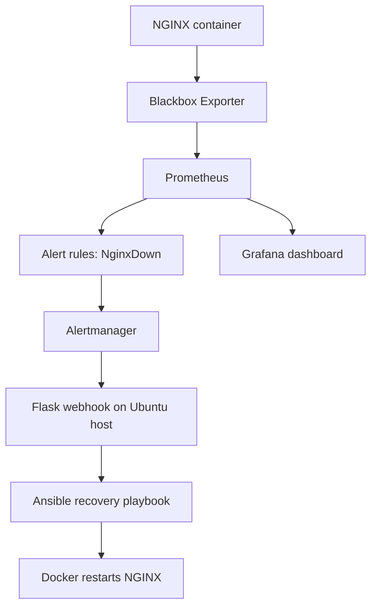

# Self-Healing Infrastructure Using Prometheus, Alertmanager & Ansible

A hands-on DevOps project that monitors an NGINX web server, detects
availability failures, sends alerts through Alertmanager, and triggers
automated recovery with Ansible.

The lab runs locally on **Ubuntu inside VirtualBox** using Docker
Compose. It does not require AWS.

## Project overview

When NGINX becomes unavailable, Prometheus detects the failed HTTP probe
through Blackbox Exporter. Prometheus fires the `NginxDown` alert,
Alertmanager forwards the alert to a Flask webhook, and the webhook runs
an Ansible playbook to restart the NGINX Docker container.

Grafana provides a dashboard for availability, response time, HTTP
status, Prometheus health, and alert state.

## Architecture



## Technology stack

-   **Ubuntu** --- lab operating system
-   **VirtualBox** --- local virtual machine environment
-   **Docker & Docker Compose** --- container runtime and service
    orchestration
-   **NGINX** --- monitored web server
-   **Prometheus** --- metrics collection and alert evaluation
-   **Prometheus Blackbox Exporter** --- HTTP availability probing
-   **Alertmanager** --- alert routing and webhook delivery
-   **Flask** --- webhook receiver
-   **Ansible** --- automated recovery playbook
-   **Grafana** --- monitoring dashboard

## Repository structure

``` text
self-healing-infrastructure/
├── docker-compose.yml
├── nginx/
├── prometheus/
│   ├── prometheus.yml
│   ├── blackbox.yml
│   └── alert-rules.yml
├── alertmanager/
│   └── alertmanager.yml
├── ansible/
│   └── restart-nginx.yml
├── webhook/
│   └── app.py
└── README.md
```

## Services and local URLs

  -------------------------------------------------------------------------------
  Service                 URL                             Purpose
  ----------------------- ------------------------------- -----------------------
  NGINX                   http://localhost:8085           Test web server

  Prometheus              http://localhost:9090           Metrics and alerts

  Alertmanager            http://localhost:9093           Alert routing

  Blackbox Exporter       http://localhost:9115           Probe exporter

  Flask webhook           http://localhost:5000/webhook   Receives Alertmanager
                                                          webhooks

  Grafana                 http://localhost:3000           Monitoring dashboard
  -------------------------------------------------------------------------------

The Flask webhook URL is an HTTP POST endpoint; opening it in a browser
with GET is not a valid webhook test.

## Prerequisites

-   Ubuntu VM with network access
-   Docker Engine
-   Docker Compose plugin (`docker compose`)
-   Python 3
-   Flask
-   Ansible

Install the host-side Python dependencies on Ubuntu:

``` bash
sudo apt update
sudo apt install -y python3-flask ansible

Alternatively, in a Python virtual environment, install Flask with `python3 -m pip install -r requirements.txt`.
```

Install Docker Engine and the Docker Compose plugin if they are not
already installed. Follow the official Docker Engine installation
instructions for your Ubuntu version.

## Setup and run

1.  Clone the repository:

    ``` bash
    git clone https://github.com/rahulkgamedev/self-healing-infrastructure.git
    cd self-healing-infrastructure
    ```

2.  Review the configuration files, especially the Alertmanager webhook
    URL. The Flask app resolves the Ansible playbook relative to its own file; set
    `ANSIBLE_PLAYBOOK` to override the playbook path. The example lab
    configuration uses:

    ``` text
    http://host.docker.internal:5000/webhook
    ```

    The Alertmanager service in `docker-compose.yml` must include the
    `host.docker.internal:host-gateway` host mapping for this Linux
    Docker lab.

3.  Start the Docker services:

    ``` bash
    sudo docker compose config
    sudo docker compose up -d
    ```

Before starting Flask, configure the lab's sudo permission so the webhook can run the Ansible playbook without an interactive password prompt. Edit with `sudo visudo -f /etc/sudoers.d/ansible-recovery` and add the following line (replace `ubuntu` with your Linux username):

    ```text
    ubuntu ALL=(root) NOPASSWD: /usr/bin/ansible-playbook
    ```

    This permission is deliberately broad and is for this isolated learning VM only. Do not use this rule on a production host; use a dedicated root-owned wrapper restricted to the single recovery playbook.

4.  Start the Flask webhook in a separate terminal from the repository
    directory:

    ``` bash
    python3 webhook/app.py
    ```

    Keep this process running while testing. For this local lab, Flask
    listens on `0.0.0.0:5000`.

5.  Check the containers:

    ``` bash
    sudo docker compose ps
    ```

6.  Open Grafana at http://localhost:3000. On first login, the default
    Grafana credentials may be `admin` / `admin` unless changed. Change
    the default password.

7.  Add Prometheus as a Grafana data source. Since Grafana and
    Prometheus are on the same Compose network, use:

    ``` text
    http://prometheus:9090
    ```

## Prometheus queries used in the dashboard

  ------------------------------------------------------------------------------------------------------------
  Panel                               PromQL
  ----------------------------------- ------------------------------------------------------------------------
  NGINX availability                  `probe_success{job="blackbox"}`

  NGINX probe duration                `probe_duration_seconds{job="blackbox"}`

  HTTP status code                    `probe_http_status_code{job="blackbox"}`

  Prometheus scrape health            `up{job="prometheus"}`

  NGINX failure alert                 `max(ALERTS{alertname="NginxDown", alertstate="firing"}) or vector(0)`
  ------------------------------------------------------------------------------------------------------------

Suggested dashboard value mappings:

-   Availability: `1 = UP`, `0 = DOWN`
-   HTTP status: `200 = HTTP OK`, `0 = No Response`
-   Prometheus health: `1 = UP`, `0 = DOWN`
-   Failure alert: `1 = FIRING`, `0 = NORMAL`

## Test the self-healing workflow

**Warning:** This test intentionally stops the NGINX container. Run it
only in the lab environment.

1.  Confirm NGINX is healthy:

    ``` bash
    curl -I http://localhost:8085
    ```

2.  Stop NGINX to simulate a failure:

    ``` bash
    sudo docker stop nginx-server
    ```

3.  Wait for Prometheus to evaluate the alert and Alertmanager to
    deliver the webhook. The configured scrape interval, alert `for`
    duration, and Alertmanager group wait affect the total time.

4.  Inspect the Flask terminal. A successful recovery should show the
    matching `NginxDown` alert and the Ansible playbook completing
    successfully.

5.  Verify the container and endpoint:

    ``` bash
    sudo docker ps --filter name=nginx-server
    curl -I http://localhost:8085
    ```

6.  Check the Prometheus alerts page at http://localhost:9090/alerts and
    the Grafana dashboard. After recovery and the next successful
    probes, availability should return to `1` and the alert should
    resolve.

## Recovery protection

The Flask webhook implementation includes a process-local thread lock to
avoid concurrent recovery executions and a cooldown to suppress rapid
repeated recovery attempts.

These controls are intentionally lightweight for a single-process local
lab. They are not distributed coordination: they reset when Flask
restarts and do not coordinate multiple Flask workers or hosts.

## Security and production considerations

This repository is a learning lab, not a production-ready deployment. The configured webhook and sudo permission are intended only for a local isolated VM.

Before using a similar design in production:

-   Replace Flask's development server with a production WSGI server.
-   Authenticate and authorize incoming webhooks; do not expose an
    unauthenticated recovery endpoint publicly.
-   Restrict the sudoers rule to a dedicated, root-owned wrapper or a
    narrowly scoped command. The lab's broad permission to run Ansible
    playbooks as root is not suitable for production.
-   Store secrets outside source control.
-   Use pinned image versions instead of `latest`.
-   Add persistent/distributed locking and robust retry/idempotency
    handling if multiple webhook workers or hosts are used.
-   Add health checks, resource limits, backups, and monitoring for the
    recovery components themselves.

## Troubleshooting

**Alertmanager shows receiver `default`**

Check the mounted file and active configuration:

``` bash
sudo docker exec alertmanager cat /etc/alertmanager/alertmanager.yml
curl -s http://localhost:9093/api/v2/status
```

Confirm the route receiver is `nginx-recovery`, then recreate
Alertmanager after editing the file:

``` bash
sudo docker compose up -d --force-recreate alertmanager
```

**Flask webhook is unreachable from Alertmanager**

-   Confirm Flask is running and bound to `0.0.0.0:5000`.

-   Confirm Alertmanager has the `host.docker.internal:host-gateway`
    mapping.

-   Inspect Alertmanager logs:

    ``` bash
    sudo docker logs --tail 100 alertmanager
    ```

**NGINX does not recover**

-   Inspect Flask logs for Ansible errors.

-   Test the playbook manually:

    ``` bash
    sudo ansible-playbook -i localhost, ansible/restart-nginx.yml
    ```

-   Check container state and logs:

    ``` bash
    sudo docker ps -a --filter name=nginx-server
    sudo docker logs --tail 50 nginx-server
    ```

## Project outcomes

The lab demonstrates:

-   Containerized service deployment with Docker Compose
-   HTTP availability monitoring with Prometheus and Blackbox Exporter
-   Alert generation and routing with Alertmanager
-   Webhook-based automation using Flask
-   Infrastructure recovery using Ansible
-   Monitoring visualization with Grafana

## Screenshots to add

Add your own screenshots to a `screenshots/` directory and link them
here after capturing them:

-   Grafana dashboard showing NGINX UP
-   Grafana dashboard showing NGINX DOWN during the failure test
-   Alertmanager showing the `NginxDown` alert
-   Flask terminal showing Ansible recovery output
-   NGINX returning HTTP 200 after recovery

Example Markdown image syntax:

``` markdown

```

## Author

**Your Name**

GitHub repository: https://github.com/rahulkgamedev/self-healing-infrastructure
